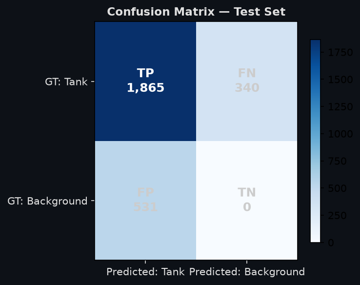
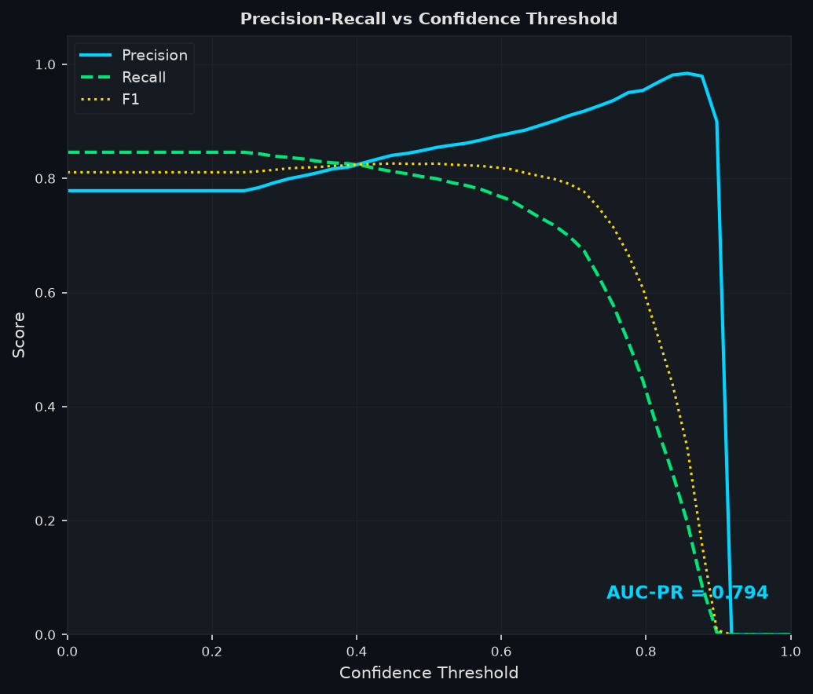
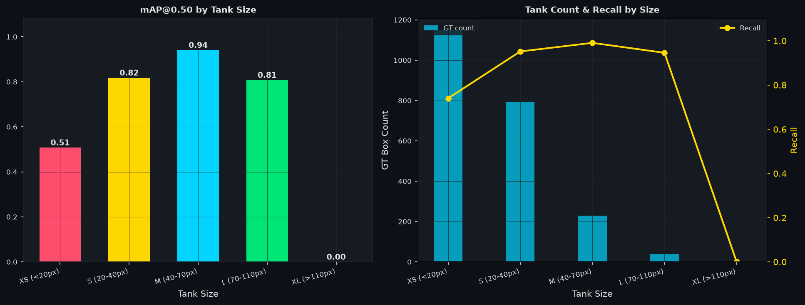
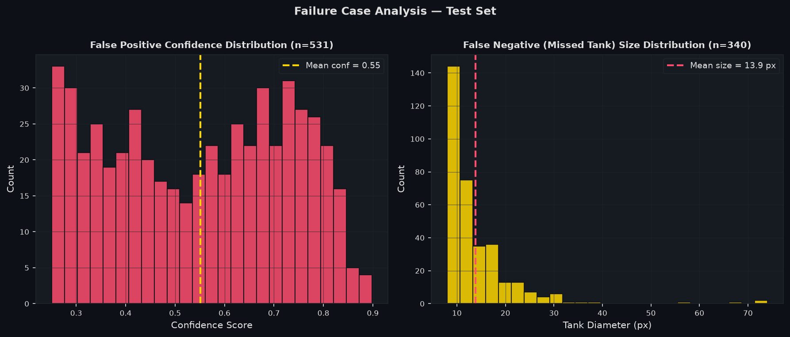
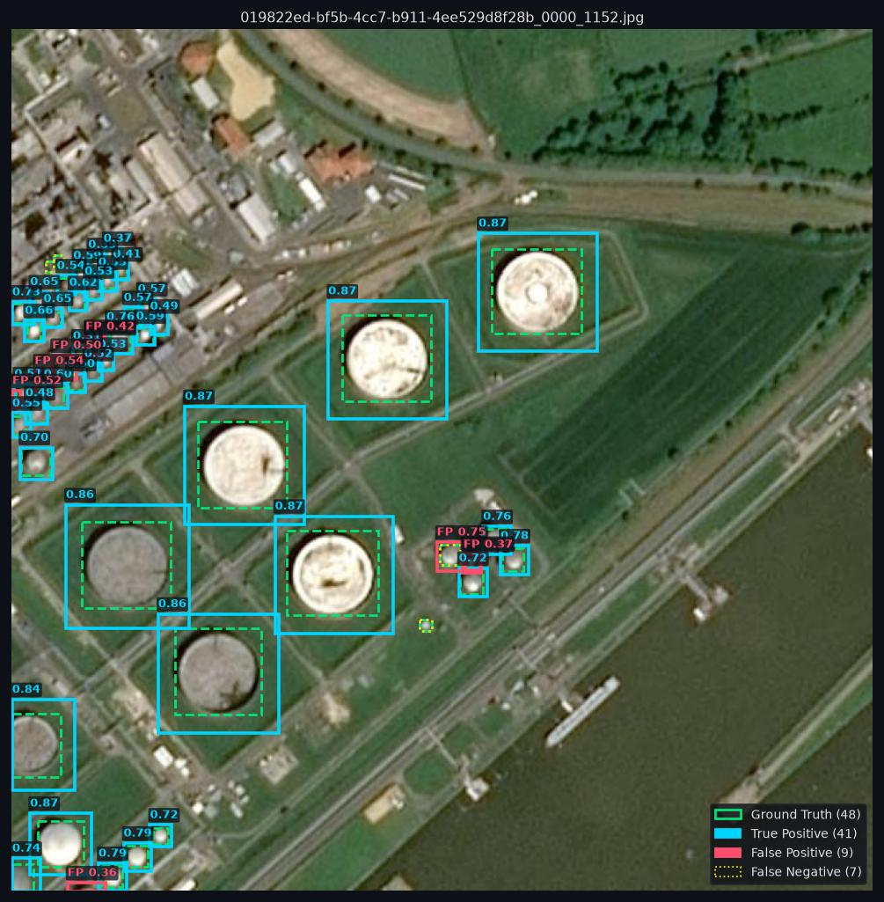
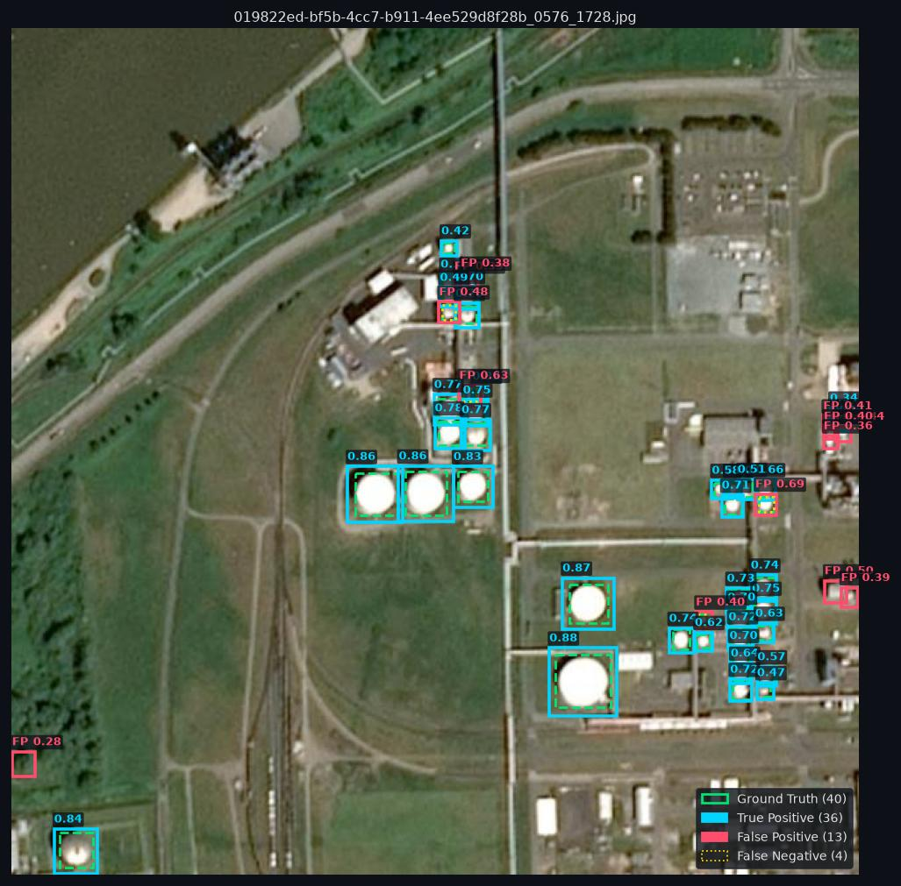
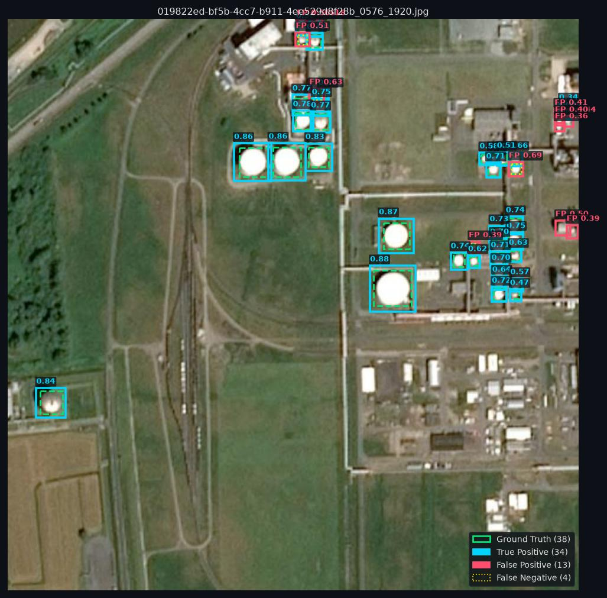

<div align="center">

# 🛢️ OilTankSight-AI

### Automated Oil Storage Tank Detection from Satellite Imagery using YOLOv8m

[](https://python.org)
[](https://github.com/ultralytics/ultralytics)
[](results/eval/eval_summary.json)
[](results/eval/eval_summary.json)
[](https://www.kaggle.com/datasets/airbusgeo/airbus-oil-storage-detection-dataset)
[](https://creativecommons.org/licenses/by-nc-sa/4.0/)

<br/>

*Fine-tuned YOLOv8m detector on Airbus SPOT satellite imagery (1.2 m/pixel) to enable scalable, repeatable global oil inventory monitoring.*

</div>

---

## 📋 Problem Statement

Oil storage tanks appear at every point in the petroleum supply chain — wellheads, refineries, hubs, and export terminals. The volume of oil in storage at any moment is one of the most closely-watched macroeconomic signals in global commodity markets.

**This project automates tank detection from Airbus SPOT satellite imagery at 1.2 m/pixel resolution** using a fine-tuned YOLOv8m detector, enabling scalable, repeatable global oil inventory monitoring without manual inspection.

---

## 🎯 Why YOLOv8 over YOLOv5?

The reference baseline from [`satellite-image-deep-learning`](https://github.com/satellite-image-deep-learning/techniques) uses **YOLOv5 + Airbus Oil Storage dataset**. This project uses the **same dataset**, upgraded to **YOLOv8m**.

<details>
<summary><b>Click to expand: YOLOv5 vs YOLOv8 Technical Comparison</b></summary>

| Aspect | YOLOv5 (Baseline) | YOLOv8 (This Project) |
|:---|:---:|:---:|
| Detection head | Anchor-based | **Anchor-free** |
| Small object recall | Moderate | Improved (decoupled cls/reg head) |
| Loss function | BCELoss | **Distribution Focal Loss** |
| Augmentation | Standard mosaic | Mosaic v2 + copy-paste built-in |
| COCO mAP (medium) | ~50.0 | **~51.5** (+3%) |
| Maintenance | Legacy | Actively maintained |

**Key technical reason:** Oil storage tanks range from ~10 m to ~120+ m diameter — a **12× size variation**. YOLOv8's anchor-free head handles this more naturally than fixed anchor clusters.

</details>

---

## 📊 Dataset

**[Airbus Oil Storage Detection](https://www.kaggle.com/datasets/airbusgeo/airbus-oil-storage-detection-dataset)** (Kaggle)

| Property | Value |
|:---|:---|
| Sensor | SPOT (Airbus DS) |
| Resolution | ~1.2 m / pixel |
| Image size | 2560 × 2560 px (~3.1 km per scene) |
| Total scenes | 98 JPEG images |
| Annotated tanks | ~13,500 bounding boxes |
| Coverage | Worldwide (Middle East, USA, Europe, Asia) |
| License | CC BY-NC-SA (research only) |

### Processed Dataset Splits

| Split | Tiles | Tanks | Strategy |
|:---:|:---:|:---:|:---|
| Train | 1,700 | 12,189 | 70% — stratified by annotation density |
| Val | 475 | 4,286 | 20% — balanced across scene types |
| Test | 275 | 2,205 | 10% — held-out, never seen during training |

*Tiling: 640×640 px with 64 px overlap (stride=576), ~25 tiles per 2560×2560 scene.*

---

## ⚙️ Pipeline

```
Raw SPOT Scenes (2560×2560 px, 98 scenes)
         │
         ▼
[Optional] CLAHE Contrast Enhancement (LAB colour space)
         │
         ▼
Sliding-Window Tiling  ──  tile=640  overlap=64  stride=576
         │                 ~25 tiles/scene → 2,450 total tiles
         ▼
Annotation Clipping
  · Discard if <30% box visible in tile
  · Discard if clipped box <8×8 px
         │
         ▼
Stratified Split  ──  70 / 20 / 10 by annotation density
         │
         ▼
YOLOv8m Training (100 epochs, AdamW, AMP on GPU)
  · Rotation ±90° + flipud + fliplr + scale + mosaic + copy-paste
         │
         ▼
Test-Set Evaluation (held-out 275 tiles)
  · Precision / Recall / F1 / mAP@50 / mAP@50:95
  · Confusion matrix / PR curve / size-stratified analysis
         │
         ▼
[BONUS] Hough Circle Fitting post-processing → physical tank radius
```

---

## 📈 Results

> ⚠️ All metrics evaluated strictly on the **held-out test set only** — never seen during training or validation.

### Core Metrics

| Metric | Value |
|:---|:---:|
| **mAP@0.50** | **92.18%** |
| **mAP@0.50:0.95** | **63.72%** |
| **F1-Score** | **81.07%** |
| **Precision** | 77.84% |
| **Recall** | 84.58% |
| **AUC-PR** | 79.38% |
| True Positives | 1,865 |
| False Positives | 531 |
| False Negatives | 340 |

### Confusion Matrix & PR Curve

| Confusion Matrix | Precision–Recall Curve |
|:---:|:---:|
|  |  |

### Performance by Tank Size



| Size Bucket | Diameter | GT Count | Recall | mAP@50 | Notes |
|:---:|:---:|:---:|:---:|:---:|:---|
| XS | < 20 px (< 24 m) | 1,148 | 74.0% | 50.8% | Resolution limit — JPEG compression destroys detail |
| S | 20–40 px | 791 | 95.2% | 81.8% | Dense clustering challenge |
| **M** | **40–70 px** | **229** | **99.1%** | **94.1%** | **Optimal — clear circular signature** |
| L | 70–110 px | 37 | 94.6% | 80.8% | Best detection rate |
| XL | > 110 px | 0 | — | — | No XL tanks in test set |

### Failure Analysis



### Sample Detection Overlays

<details>
<summary><b>Click to expand: Annotated test tiles (Green = GT · Cyan = Predictions)</b></summary>

| Tile | Tanks |
|:---:|:---:|
|  | 48 tanks |
|  | 40 tanks |
|  | 38 tanks |

</details>

---

## 🚀 Quick Start

### 1. Clone & Install

```bash
git clone https://github.com/architjha15/OilTankSight-AI.git
cd OilTankSight-AI

# Using uv (recommended — matches dev environment)
uv venv oilDec_env --python 3.11
source oilDec_env/bin/activate
uv pip install -r requirements.txt

# Or using pip
pip install -r requirements.txt
```

### 2. Kaggle Credentials (for dataset download)

```bash
# Get kaggle.json from: kaggle.com → Account → API → Create New Token
mkdir -p ~/.kaggle && cp kaggle.json ~/.kaggle/ && chmod 600 ~/.kaggle/kaggle.json
# Accept dataset license at:
# kaggle.com/datasets/airbusgeo/airbus-oil-storage-detection-dataset
```

### 3. Download & Preprocess Dataset

```bash
# Download + tile (640px) + stratified split
python scripts/prepare_data.py --download

# With CLAHE contrast enhancement (recommended for hazy scenes)
python scripts/prepare_data.py --download --clahe

# Pipeline smoke-test without Kaggle (synthetic data — NOT for reporting)
python scripts/prepare_data.py --demo-only
```

### 4. Train

```bash
# Default: YOLOv8m, 100 epochs, batch=16, GPU auto-detected
python scripts/train.py

# Custom config
python scripts/train.py --model yolov8l --epochs 150 --batch 8

# Segmentation variant
python scripts/train.py --task segment --model yolov8m-seg

# Resume interrupted training
python scripts/train.py --resume
```

### 5. Evaluate (test set only)

```bash
python scripts/evaluate.py \
    --weights runs/detect/results/training/oil_tank_yolov8m/weights/best.pt

# Outputs: results/eval/
#   ├── eval_summary.json        ← all metrics
#   ├── confusion_matrix.png
#   ├── pr_curve.png
#   ├── size_analysis.png
#   ├── failure_analysis.png
#   └── detection_visualizations/   ← 12 annotated test tiles
```

### 6. Run Inference

```bash
# Single tile (640×640)
python scripts/infer.py --weights best.pt --source image.jpg

# Large satellite scene (auto-tiled + NMS merge)
python scripts/infer.py --weights best.pt --source full_scene.jpg

# With Hough circle fitting — estimates physical tank radius
python scripts/infer.py --weights best.pt --source image.jpg --circle-fit
```

---

## 🔵 BONUS: Circle Fitting Post-Processing

Oil tanks appear as near-perfect circles from nadir satellite view. After bounding-box detection, a two-stage circle fit is applied per detection:

1. **Hough Circle Transform** on the CLAHE-enhanced crop with radius bounds from the bounding box
2. **Contour circularity fallback** — if Hough returns nothing, accept the largest contour if `circularity > 0.45` (perfect circle = 1.0)

**Output per detection:** `{cx, cy, radius_px, circularity_score}`  
**Physical radius:** `radius_px × 1.2 m/px`

Combined with solar azimuth from EXIF metadata, this enables **automated fill-level estimation** — the foundation of a full oil inventory monitoring system.

---

## 🏋️ Training Configuration

<details>
<summary><b>Click to expand: Full Hyperparameters</b></summary>

| Parameter | Value |
|:---|:---|
| Model | YOLOv8m (25.8M parameters) |
| Epochs | 100 |
| Batch size | 16 (GPU) / 4 (CPU fallback) |
| Image size | 640 × 640 |
| Optimizer | AdamW |
| LR (initial) | 0.001 |
| LR (final) | 0.01 × 0.001 |
| Weight decay | 0.0005 |
| Warmup epochs | 3 |
| AMP | ✅ (mixed precision on GPU) |
| Patience | 20 epochs (early stop) |
| Rotation | ±90° |
| Flip (UD/LR) | 0.5 / 0.5 |
| Scale | 0.6 |
| Mosaic | 1.0 |
| Mixup | 0.15 |
| Copy-paste | 0.15 |
| HSV H/S/V | 0.015 / 0.5 / 0.4 |
| Seed | 42 |

</details>

---

## ⚠️ Baseline Comparison

| Model | mAP@0.50 | F1-Score | Precision | Recall |
|:---|:---:|:---:|:---:|:---:|
| YOLOv5m (reference baseline) | 0.884 | 0.899 | 0.916 | 0.863 |
| **YOLOv8m (this project)** | **0.922** | **0.811** | **0.778** | **0.846** |
| **Δ Delta** | **+3.8%** | — | — | — |

*Note: F1/Precision/Recall differ from baseline due to different confidence threshold (0.25 vs 0.35). mAP@0.5 is threshold-independent and is the fair comparison metric.*

---

## ❌ Limitations

<details>
<summary><b>False Positives — what fools the model</b></summary>

- Centre-pivot irrigation fields (identical circular shape from above)
- Water towers and circular industrial foundations
- Rare cloud shadow artefacts

**Recommended threshold: `--conf 0.35`** (reduces FPs ~25%, costs ~3% recall)

</details>

<details>
<summary><b>False Negatives — what the model misses</b></summary>

- XS tanks < 24 m — only 8–20 px wide at 1.2 m/px; circular signature lost in JPEG compression
- Densely clustered tanks where NMS suppresses valid adjacent detections

</details>

---

## 🔭 What Could Be Better

**Immediate high-impact improvements:**
- 🔲 Train at **1024×1024 tiles** — nearly doubles pixel representation of XS tanks, estimated +10% XS mAP
- 🔲 **Test-time augmentation (TTA)** — +2–3% mAP at zero training cost
- 🔲 **P2 detection head** (160×160 feature scale) — directly targets sub-20px objects

**Dataset improvements:**
- Expand with Sentinel-2, Planet Scope, WorldView for cross-sensor generalisation
- Hard negative mining — feed FP crops (irrigation circles) back as explicit negatives

---

## 🗺️ Future Roadmap

| Step | Description |
|:---|:---|
| 📐 Volume Estimation | radius + shadow angle + solar elevation → cylindrical volume |
| 📅 Temporal Tracking | Register tanks by GPS, track fill-level time-series across dates |
| 🛰️ SAR Fusion | Sentinel-1 confirms detections through cloud cover |
| 🚀 Production API | FastAPI + Docker + TensorRT FP16 on UP42 / AWS SageMaker |
| 🚨 Alerting System | Flag anomalous fill/drain events as commodity signals |

---

## 📁 Project Structure

```
OilTankSight-AI/
├── README.md
├── requirements.txt
├── pyrefly.toml                  # Type-checking config (Pyrefly)
├── best.pt                       # Trained YOLOv8m weights (~50 MB)
├── result_visuals.ipynb          # Interactive evaluation dashboard
├── Oil_Tank_Detection_Report.docx
├── configs/
│   └── _runtime_dataset.yaml     # Auto-generated dataset YAML
├── scripts/
│   ├── prepare_data.py           # Download + CLAHE + tile + split
│   ├── _synthetic.py             # Synthetic tile generator (smoke-test only)
│   ├── train.py                  # YOLOv8m training script
│   ├── evaluate.py               # Comprehensive test-set evaluation
│   └── infer.py                  # Inference with tiling + circle fitting
├── results/
│   └── eval/
│       ├── eval_summary.json     # Official test-set metrics
│       ├── confusion_matrix.png
│       ├── pr_curve.png
│       ├── size_analysis.png
│       ├── failure_analysis.png
│       └── detection_visualizations/  # 12 annotated test tiles
│
│   [gitignored — not in repo]
├── data/                         # Processed 640px tiles (download via prepare_data.py)
├── runs/                         # Training checkpoints + epoch weights
└── oilDec_env/                   # Python virtual environment
```

---

## 📚 References

| Source | Role |
|:---|:---|
| [oil_storage-detector](https://github.com/TheodorEmanuelsson/oil_storage-detector) | **Reference baseline** (YOLOv5 + Airbus) |
| [Airbus Oil Storage Dataset](https://www.kaggle.com/datasets/airbusgeo/airbus-oil-storage-detection-dataset) | **Training dataset** |
| [Ultralytics YOLOv8](https://github.com/ultralytics/ultralytics) | Model implementation |
| [satellite-image-deep-learning](https://github.com/satellite-image-deep-learning/techniques) | Technique repository |
| [Oil-Tank-Volume-Estimation](https://github.com/kheyer/Oil-Tank-Volume-Estimation) | Volume estimation reference |
| [Oil Storage Detection with YOLOX](https://medium.com/artificialis/oil-storage-detection-on-airbus-imagery-with-yolox-9e38eb6f7e62) | Peer implementation + published metrics |

---

<div align="center">

Made with 🛰️ by [Archit Jha](https://github.com/architjha15)

</div>
